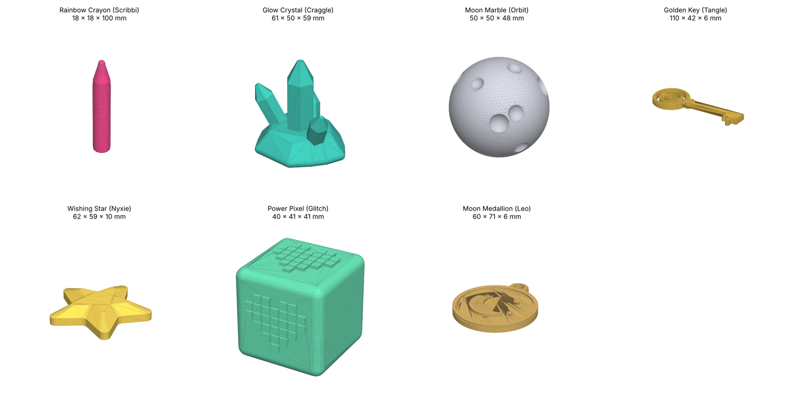

# Imagamigos — Treasure Models (3D files for manufacturing)

The seven "lost treasures" that kids hunt for in the Imagamigos game, as 3D files ready for
prototyping and quoting.

## What's included
| File | What it is |
|---|---|
| `stl/*.stl` | One 3D model per treasure. Units are **millimetres**. Each model is a single closed, watertight solid, sitting flat on z = 0. |
| `previews/*.png` | A preview picture of each treasure with its size. |
| `make_treasures.py` | The script that builds the models. Change sizes or details here and run it again to regenerate the files. |
| `imagamigos_treasures.zip` | Everything above in one file to send to a manufacturer. |

## The treasures
| # | Treasure | Character | Size (mm, W × D × H) | Volume | Suggested colour / material |
|---|---|---|---|---|---|
| 1 | Rainbow Crayon | Scribbi | 18 × 18 × 100 | 22 cm³ | 6 rainbow bands, divided by grooves (paint, or print in several colours); pink tip |
| 2 | Glow Crystal | Craggle | 61 × 50 × 59 | 39 cm³ | Translucent teal or **glow-in-the-dark** plastic; grey rock base |
| 3 | Moon Marble | Orbit | 50 × 50 × 48.5 | 65 cm³ | Pale grey / silver, with craters; small flat spot underneath so it stands up |
| 4 | Golden Key | Tangle | 110 × 42 × 6 | 10 cm³ | Gold; maze pattern in the round end, with a hole for a ribbon |
| 5 | Wishing Star | Nyxie | 62 × 59 × 10.5 | 15 cm³ | Yellow or gold, could be glow-in-the-dark; rounded points |
| 6 | Power Pixel | Glitch | 40 × 41 × 41 | 63 cm³ | Mint green; raised pixel hearts on the top and front |
| 7 | Moon Medallion | Leo | 60 × 71 × 6.4 | 14 cm³ | Gold, with a raised crescent moon and stars; loop for a ribbon |

The colours match the characters in the game. Any colour can be swapped.

## Child-safety design notes
The models were designed with children's toy rules in mind, but **the finished products must still
be tested by an accredited lab** before sale: ASTM F963 / CPSIA in the US, EN 71 in the EU and UK.
- **No small parts:** every treasure is too large to fit inside the small-parts test cylinder
  (31.7 mm wide, 57.1 mm deep) in any direction.
- **Ball size:** the Moon Marble is 50 mm across, above the 44.5 mm small-ball limit.
- **No sharp points or edges:** the crayon tip and crystal tips are blunted, the star points are
  rounded, and the corners of the key, medallion and cube are rounded or bevelled.
- **Ribbons and cords:** the key and medallion have holes for a ribbon. For young children, keep any
  ribbon short (ASTM F963 cord-length limits apply) or leave it off.
- **Materials:** use toy-safe plastics (PLA, ABS or PP) and non-toxic, lead-free paints and pigments
  that meet ASTM F963 / EN 71-3 limits on heavy metals.
- **Age label:** decide the age grade with your testing lab. The game itself is aimed at about ages
  4–10, played with a grown-up.

## Printing / production notes
- **3D printing (prototypes):** 0.2 mm layers, 3 walls, 20–25 % infill. Every treasure prints flat side
  down. The Glow Crystal's tilted side crystals need a little support; the others need none.
- **Mass production (injection moulding):** STL files are fine for quotes and prototypes. For moulds,
  factories usually rebuild the model in their own CAD software (STEP format) and add draft angles and
  parting lines. Share these files and the previews as the design reference.
- **Branding:** a small raised or engraved "Imagamigos" mark can be added by the factory, for example on
  the back of the medallion or the base of the crystal.
